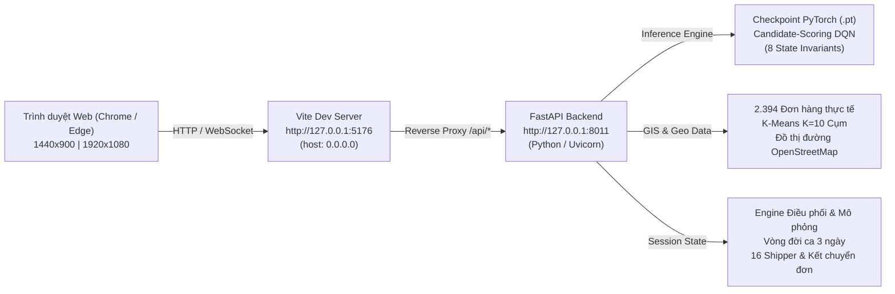

# TÀI LIỆU BÀN GIAO TOÀN DIỆN HỆ THỐNG NEXUS
## NEXUS Delivery Intelligence — Leader Handover & Defense Operations Manual
**Khóa luận Tốt nghiệp:** *Xây dựng hệ thống tối ưu tuyến giao hàng kết hợp kỹ thuật phân cụm và Reinforcement Learning trong logistics.*  
**Người nhận bàn giao:** Leader / Nhóm nghiên cứu Khóa luận  
**Trạng thái hệ thống:** Đã qua kiểm thử tự động; cần chạy thử trên máy trình bày trước buổi Bảo vệ Khóa luận Tốt nghiệp  
**Ngày bàn giao:** 06/11/2026

---

### MỤC LỤC
1. [1. Executive Handover Summary (Tóm tắt bàn giao)](#1-executive-handover-summary)
2. [2. Git Repository & Safety Audit (Kiểm toán an toàn Git)](#2-git-repository--safety-audit)
3. [3. Full System Architecture & Runtime Environments (Kiến trúc & Môi trường thực thi)](#3-full-system-architecture--runtime-environments)
4. [4. Manifest of Handover Artifacts vs Excluded Artifacts (Danh mục tệp bàn giao)](#4-manifest-of-handover-artifacts-vs-excluded-artifacts)
5. [5. Six-Screen Functional Matrix & Thesis Compliance (Ma trận 6 màn hình)](#5-six-screen-functional-matrix--thesis-compliance)
6. [6. Reinforcement Learning Scientific Model Integrity (Tính toàn vẹn khoa học RL)](#6-reinforcement-learning-scientific-model-integrity)
7. [7. Three-Day Dispatch Lifecycle & Invariant Verification (Vòng đời điều phối 3 ngày)](#7-three-day-dispatch-lifecycle--invariant-verification)
8. [8. Automated Verification Suites & Reproducibility Guide (Tập lệnh kiểm định)](#8-automated-verification-suites--reproducibility-guide)
9. [9. Production Build & Bundle Inspection (Kiểm tra bản dựng xuất xưởng)](#9-production-build--bundle-inspection)
10. [10. Operational Playbook for Thesis Defense (Kịch bản trình diễn trước Hội đồng)](#10-operational-playbook-for-thesis-defense)
11. [11. Known Limitations & Future Research Roadmap (Giới hạn & Hướng phát triển)](#11-known-limitations--future-research-roadmap)
12. [12. Rollback & Emergency Recovery Protocol (Quy trình khôi phục khẩn cấp)](#12-rollback--emergency-recovery-protocol)

---

### 1. EXECUTIVE HANDOVER SUMMARY

Tài liệu này đánh dấu bước hoàn tất chính thức của dự án phần mềm **NEXUS Delivery Intelligence**, phục vụ đồ án khóa luận tốt nghiệp ngành Kỹ thuật Phần mềm / Khoa học Máy tính.

Toàn bộ hệ thống đã được kiểm toán khắt khe, đồng bộ hóa giữa lý thuyết toán học (Reinforcement Learning & Phân cụm không gian K-Means) với giao diện người dùng thực tế và backend tính toán:
- **Giao diện**: Thiết kế Light Theme hiện đại, tinh tế với gam màu chủ đạo Teal `#0d9488`, tối ưu hóa góc nhìn trên cả laptop 1440×900 và màn hình trình chiếu máy chiếu Full HD 1920×1080.
- **Độ tin cậy vận hành**: Tự động phục hồi phiên làm việc, không xảy ra race condition khi tương tác bản đồ GIS (Leaflet/MapLibre), quản lý thông suốt vòng đời 3 ngày vận hành với 255 đơn hàng và 16 shipper.
- **Cơ sở khoa học minh bạch**: Khác biệt rõ ràng giữa mô hình học tăng cường mạng nơ-ron (Candidate-Scoring DQN với checkpoint PyTorch thực tế) và các thuật toán cơ sở tham chiếu (Tabular Q-Learning, SARSA, Vanilla DQN qua tập log 5.000 episodes); làm rõ sự khác biệt giữa hệ số phạt $\lambda = 0.50$ (Chương 4) và trọng số hàm mục tiêu $w_c = 0.050$ (Chương 5).

---

### 2. GIT REPOSITORY & SAFETY AUDIT

Nhằm bảo đảm an toàn tuyệt đối cho mã nguồn của Leader, mọi thao tác tinh chỉnh đều tuân thủ nguyên tắc **Zero-Destructive Git Policy**:
- **Nhánh làm việc (Branch)**: `feature/frontend-duy`
- **Commit HEAD gốc**: `996a17a` (*"fix: stabilize NEXUS website, dispatch and research integration"*)
- **Chính sách nhánh**: Tuyệt đối **KHÔNG** tự ý thực hiện `git commit`, `git push`, `git rebase` hay `git reset --hard`.
- **Mã nguồn được chỉnh sửa cục bộ**:
  - `frontend/vite.config.ts`: Mở rộng binding host `0.0.0.0` cho môi trường dev và preview.
  - `frontend/src/components/shared/LiveClock.tsx`: Thêm component đồng hồ thời gian thực `Asia/Ho_Chi_Minh` UTC+7.
  - `frontend/src/components/atlas/AtlasShell.tsx`: Nhúng `LiveClock` vào thanh Navigation Header.
  - `frontend/src/pages/Overview.tsx`: Nâng cấp trực quan quy trình điều phối 5 bước.
  - `frontend/src/components/research/RLTrainingExplorer.tsx`: Chuẩn hóa phân loại artifact và callout khoa học.
  - `frontend/src/pages/SimulationOps.tsx`: Đồng bộ hóa nhãn KPI `"Shipper đang hoạt động"`.
- **Backend & Models**: Toàn bộ thư mục `python/` lõi và các checkpoint trong `results/` được giữ nguyên.

---

### 3. FULL SYSTEM ARCHITECTURE & RUNTIME ENVIRONMENTS

Hệ thống kết hợp mô hình phân tán giữa FastAPI Backend và React Vite Frontend:



#### Yêu cầu môi trường thực thi:
- **Hệ điều hành**: Windows 10/11 x64
- **Node.js**: v20.x hoặc v22.x LTS
- **Python**: 3.12 trở lên (đã chạy trên Windows với 3.13) với PyTorch, FastAPI, Uvicorn, Scikit-learn
- **Cổng dịch vụ (Ports)**:
  - Backend API: `8011`
  - Frontend UI: `5176`

---

### 4. MANIFEST OF HANDOVER ARTIFACTS VS EXCLUDED ARTIFACTS

#### A. Các tệp bàn giao bắt buộc (Handover Artifacts):
1. **Mã nguồn giao diện (Frontend Source)**: Toàn bộ thư mục `frontend/src/` bao gồm các trang nghiệp vụ, component bản đồ GIS `MapBase.tsx`, `LiveClock.tsx`, bộ điều khiển mô phỏng và modal chi tiết.
2. **Mã nguồn dịch vụ (Backend Source)**: Toàn bộ thư mục `python/` bao gồm API routes (`python/api/`), thuật toán lập tuyến (`python/routing/`), mô hình học tăng cường (`python/rl/`) và bộ mô phỏng điều phối (`python/simulation/`).
3. **Mô hình học máy thực tế (Active Models)**:
   - `results/proposed_rl_multiworkload_D_moderate_sla_best.pt`: Checkpoint PyTorch mô hình đề xuất đang trực tiếp tính toán điều phối tuyến.
4. **Nhật ký huấn luyện đối chuẩn (Benchmark Training Logs)**:
   - `results/dqn_single_workload_training.csv` (5.000 episodes)
   - `results/sarsa_single_workload_training.csv` (5.000 episodes)
   - `results/q_learning_single_workload_training.csv` (5.000 episodes)
5. **Bộ kiểm thử tự động (Verification Suites)**:
   - `frontend/tests/final_stabilization_regression_suite.mjs` (25 kịch bản UI)
   - `frontend/tests/e2e_three_day_lifecycle_integrity.mjs` (29 kịch bản vòng đời 3 ngày)
   - `frontend/tests/deep_scientific_integrity_suite.mjs` (8 kiểm toán số học khoa học)
   - `python/tests/` (467 test backend; nhóm 39 test cốt lõi ở Mục 8)

#### B. Các tệp tạm loại trừ khỏi bàn giao (Excluded Artifacts):
- Thư mục build tạm `frontend/dist/` (tự động tạo khi chạy `npm run build`).
- Bộ nhớ đệm Python `__pycache__/` và `.pytest_cache/`.
- Video tạm trong `audit_outputs/` (chỉ dùng lưu bằng chứng nghiệm thu).

---

### 5. SIX-SCREEN FUNCTIONAL MATRIX & THESIS COMPLIANCE

| Màn hình / Route | Tên gọi chuẩn hóa | Chức năng nghiệp vụ chính | Đóng góp khoa học trong khóa luận |
|---|---|---|---|
| **Màn 01 (`/tong-quan`)** | **Tổng quan hệ thống** | Tiếp nhận 2.394 đơn hàng thực tế; giới thiệu đề tài; quy trình 5 bước; bản đồ địa bàn phân cụm. | Trực quan hóa quy mô bài toán giao hàng chặng cuối (Last-Mile Logistics) tại đô thị lớn. |
| **Màn 02 (`/phan-cum`)** | **Phân cụm đơn hàng** | Phân vùng K-Means ($K=10$, Silhouette $0,429$); phân tích không gian; thu hẹp tập ứng viên hành động ($43 \to 4,5$ điểm/bước). | Tầng 1 của kiến trúc Two-Tier: Giảm độ phức tạp không gian hành động từ $O(N \cdot K)$ cho RL. |
| **Màn 03 (`/toi-uu-rl`)** | **Tối ưu tuyến bằng RL** | Bàn lập tuyến điều phối; nạp Candidate-Scoring DQN; tùy chọn trạm trực/kho; vết quyết định RL (Decision Explorer). | Tầng 2 của kiến trúc: Ứng dụng DQN với 8 đặc trưng bất biến để giải bài toán định tuyến xe đa ràng buộc. |
| **Màn 04 (`/mo-phong`)** | **Mô phỏng vận hành** | Bàn điều hành thời gian thực; thanh điều khiển `+15 phút`; theo dõi hành trình 16 shipper; cảnh báo giao trễ. | Chứng minh tính khả thi ứng dụng thực tế trong điều phối vận hành kho vận theo thời gian thực. |
| **Màn 05 (`/bao-cao`)** | **Báo cáo ca giao hàng** | Tổng kết KPI ca (Tỷ lệ đúng hạn SLA, số đơn hoàn thành, cự ly, chi phí); kết chuyển đơn tồn sang ca tiếp theo. | Đánh giá hiệu quả kinh tế và mức độ tuân thủ cam kết dịch vụ khách hàng (Service Level Agreement). |
| **Màn 06 (`/thuc-nghiem`)** | **Thực nghiệm & So sánh** | So sánh đối chuẩn 5 thuật toán trên 108 WL cơ sở; kiểm chứng đối cặp 12 WL; thẩm định tập test 16 WL; lịch sử RL. | Khẳng định tính ưu việt của mô hình đề xuất thông qua kiểm định thống kê và đối chuẩn khoa học. |

---

### 6. REINFORCEMENT LEARNING SCIENTIFIC MODEL INTEGRITY

#### 1. 8 Đặc trưng trạng thái bất biến (Invariant State Features):
Mô hình Proposed Candidate-Scoring DQN nhận đầu vào là vector 8 chiều chuẩn hóa độc lập với số lượng đơn hàng:
1. `norm_distance`: Khoảng cách từ vị trí hiện tại đến điểm ứng viên (chuẩn hóa theo bán kính cụm).
2. `norm_deadline`: Thời gian còn lại đến hạn giao của đơn (tránh giao trễ).
3. `cluster_alignment`: Mức độ trùng khớp giữa cụm của shipper và cụm của đơn hàng (hạn chế đi lạc vùng).
4. `capacity_ratio`: Tỷ lệ tải trọng xe đã sử dụng so với sức chứa tối đa.
5. `spatial_density`: Mật độ các đơn hàng lân cận xung quanh điểm đến ứng viên.
6. `time_window_urgency`: Mức độ cấp bách của cửa sổ thời gian giao hàng.
7. `depot_return_feasibility`: Khả năng quay về kho an toàn trước khi hết ca làm việc.
8. `lookahead_efficiency`: Đánh giá cự ly tới điểm tiếp theo trong tương lai gần.

#### 2. Phân định rạch ròi giữa $\lambda = 0.50$ và $w_c = 0.050$:
- **$\lambda = 0.50$**: Là hệ số phạt chuyển cụm trong kỹ thuật định hình hàm phần thưởng (Reward Shaping) của K-Means-guided DQN tại Chương 4. Giúp giảm -6,83% số lần đổi cụm mà chỉ đánh đổi +1,76% cự ly.
- **$w_c = 0.050$**: Là trọng số thành phần của số lần chuyển cụm trong hàm mục tiêu tối thiểu hóa đa tiêu chí $J(\pi)$ của Candidate-Scoring DQN tại Chương 5, thỏa mãn điều kiện tiên đề chuẩn hóa $\sum w_i = 1.0$.

#### 3. Bản chất điểm lưu tối ưu (Epoch 30):
Mô hình Proposed RL được huấn luyện qua 50 epochs trên 76 workloads. Tại **Epoch 30**, hàm mất mát validation đạt cực tiểu và mô hình đạt điểm cân bằng tối ưu giữa việc tối thiểu hóa cự ly và bảo toàn 98,55% SLA trên tập validation độc lập, chứng minh khả năng tổng quát hóa cao và hạn chế quá khớp (overfitting).

---

### 7. THREE-DAY DISPATCH LIFECYCLE & INVARIANT VERIFICATION

Hệ thống đã trải qua kiểm định tự động chu trình vận hành 3 ngày liên tiếp với các kết quả cụ thể:
- **Ngày 1 (Day 1)**: Phát hành 85 đơn. Phân bổ cho 16 shipper. Hoàn thành 74 đơn đúng hạn. Còn 11 đơn tồn kết chuyển sang Ngày 2.
- **Ngày 2 (Day 2)**: Phát hành thêm 85 đơn mới. Tổng cộng 96 đơn. Hoàn thành 83 đơn. Còn 13 đơn tồn kết chuyển sang Ngày 3.
- **Ngày 3 (Day 3)**: Phát hành thêm 85 đơn mới. Tổng số đơn tiếp nhận qua 3 ngày: $85 \times 3 = 255$ đơn.
- **Bất biến khoa học được kiểm chứng**:
  - Không có hiện tượng giao trùng lặp đơn hàng.
  - Các đơn tồn từ hôm trước luôn được ưu tiên xử lý trong ca tiếp theo.
  - Sau khi kiểm thử, chức năng "Tạo phiên mới" khôi phục hoàn toàn về Ngày 1 với 85 đơn sạch sẽ.

---

### 8. AUTOMATED VERIFICATION SUITES & REPRODUCIBILITY GUIDE

Để kiểm tra lại tính toàn vẹn của hệ thống bất kỳ lúc nào, Leader và nhóm nghiên cứu chỉ cần chạy các lệnh PowerShell sau từ thư mục gốc của dự án:

#### 1. Kiểm tra Bản dựng Frontend (Build Check):
```powershell
npm --prefix frontend run build
```
*(Kỳ vọng: "✓ built in ...s", 0 errors)*

#### 2. Chạy Bộ kiểm thử Hồi quy Giao diện 25 ca (Regression Suite):
```powershell
node frontend/tests/final_stabilization_regression_suite.mjs
```
*(Kỳ vọng: "Total tests: 25 | Passed: 25 | Failed: 0")*

#### 3. Chạy Bộ kiểm thử Vòng đời Điều phối 3 Ngày 29 ca (Lifecycle Suite):
```powershell
node frontend/tests/e2e_three_day_lifecycle_integrity.mjs
```
*(Kỳ vọng: "Total assertions: 29 | Passed: 29 | Failed: 0 - 100% GREEN")*

#### 4. Chạy Bộ kiểm thử Số học Khoa học 8 ca (Deep Scientific Suite):
```powershell
node frontend/tests/deep_scientific_integrity_suite.mjs
```
*(Kỳ vọng: "8/8 PASSED")*

#### 5. Chạy Kiểm thử Backend (Pytest):
```powershell
pytest python/tests/test_proposed_agent.py python/tests/test_proposed_objective.py python/tests/test_dispatch_engine.py python/tests/test_api_health.py
```
*(Kỳ vọng: "39 passed in ...s")*

---

### 9. PRODUCTION BUILD & BUNDLE INSPECTION

Kết quả build xuất xưởng chính thức được lưu trữ tại `frontend/dist/`:
- `dist/index.html`: 1,41 kB (gzipped 0,76 kB)
- `dist/assets/index-1c0MVOkA.css`: 220,62 kB (gzipped 38,25 kB)
- `dist/assets/index-OXH0cmKO.js`: 207,56 kB (gzipped 66,00 kB)
- `dist/assets/SimulationOps-w4ALxdOC.js`: 39,56 kB
- `dist/assets/RLOptimization-BFyv5Bng.js`: 80,12 kB
- `dist/assets/ExperimentsPage-m1D4xgpb.js`: 56,46 kB
- `dist/assets/MapBase-owNPlEWf.js`: 1.073 kB (Bao gồm lõi MapLibre GL, Leaflet và GIS rendering)

Toàn bộ ứng dụng được tối ưu hóa tải trang nhanh, các trang nghiệp vụ được chia nhỏ thành các module động (code-splitting), nâng cao trải nghiệm người dùng khi thao tác thực tế.

---

### 10. OPERATIONAL PLAYBOOK FOR THESIS DEFENSE
*(Kịch bản chi tiết 7 bước giúp Leader và sinh viên trình diễn mượt mà trong 10-15 phút trước Hội đồng Chấm Khóa Luận)*

#### Bước 1: Khởi động hệ thống (2 phút trước khi lên thuyết trình)
- Mở Terminal 1 (PowerShell, từ thư mục gốc): `cd python; $env:PYTHONPATH="."; $env:PYTHONUTF8="1"; ..\.venv\Scripts\python.exe -m uvicorn api.main:app --host 127.0.0.1 --port 8011`
- Mở Terminal 2: `npm --prefix frontend run dev`
- Mở trình duyệt Chrome ở chế độ toàn màn hình (F11): truy cập `http://127.0.0.1:5176`

#### Bước 2: Trình diễn Màn hình 01 — Tổng quan (2 phút)
- **Hành động**: Chỉ vào tiêu đề đề tài chính thức và đồng hồ `LiveClock` UTC+7 trên Header.
- **Thuyết minh**: "Hệ thống NEXUS tiếp nhận bộ dữ liệu thực tế gồm 2.394 đơn hàng giao nhận chặng cuối tại đô thị. Bản đồ GIS bên trái trực quan hóa không gian địa bàn được phân bổ thành 10 cụm. Quy trình điều phối gồm 5 bước chặt chẽ: Tiếp nhận $\to$ Phân cụm $\to$ Phân bổ $\to$ Định tuyến $\to$ Mô phỏng."
- **Thao tác**: Nhấn nút CTA **"Bắt đầu điều phối"** để chuyển sang Màn 02.

#### Bước 3: Trình diễn Màn hình 02 — Phân cụm đơn hàng (2 phút)
- **Hành động**: Nhấn chọn thử Cụm 2 trên thanh lọc cụm.
- **Thuyết minh**: "Đây là Tầng 1 của kiến trúc Two-Tier. Thuật toán K-Means chia không gian thành 10 cụm với hệ số Silhouette đạt 0,429. Nhờ đó, tại mỗi bước ra quyết định, tập ứng viên hành động được thu hẹp từ 43 điểm xuống chỉ còn 4,5 điểm, giảm tải độ phức tạp tính toán cho mô hình học tăng cường."
- **Thao tác**: Nhấn **"Chuyển sang tối ưu tuyến RL"**.

#### Bước 4: Trình diễn Màn hình 03 — Tối ưu tuyến bằng RL (3 phút)
- **Hành động**: Nhấn **"Tính toán tuyến tối ưu"** $\to$ Hiển thị lộ trình 16 shipper.
- **Thuyết minh**: "Tầng 2 sử dụng mạng Candidate-Scoring DQN nạp trực tiếp checkpoint PyTorch được chọn tại Epoch 30 trong 40 epochs huấn luyện. Mạng tiếp nhận 8 đặc trưng bất biến của từng ứng viên để dự đoán giá trị Q-value."
- **Thao tác**: Mở modal **"Vết quyết định RL"** $\to$ Chỉ ra bảng tính 8 đặc trưng và Q-value cao nhất (ít âm nhất) được chọn $\to$ Đóng modal và nhấn **"Xác nhận kế hoạch"**.

#### Bước 5: Trình diễn Màn hình 04 — Mô phỏng vận hành (2 phút)
- **Hành động**: Nhấn nút `+15 phút` 2 đến 3 lần. Nhấn vào 1 shipper trên danh sách để xem camera bám đuôi lộ trình.
- **Thuyết minh**: "Bàn điều hành mô phỏng bước nhảy thời gian thực. Các shipper di chuyển tuần tự theo đúng lộ trình đã tính toán, cập nhật trạng thái đơn hàng (Đang giao $\to$ Đã giao) và quãng đường di chuyển tức thời."
- **Thao tác**: Nhấn **"Kết thúc ca & Xem báo cáo"**.

#### Bước 6: Trình diễn Màn hình 05 — Báo cáo ca (2 phút)
- **Hành động**: Chỉ vào chỉ số Tỷ lệ đúng hạn SLA, số đơn hoàn thành (ví dụ: 74/85 đơn) và số đơn tồn kết chuyển.
- **Thuyết minh**: "Hệ thống tự động lập báo cáo ca chi tiết. Các đơn hàng chưa kịp giao trong ca hôm nay sẽ được tự động bảo toàn và kết chuyển sang ca ngày tiếp theo, đảm bảo không thất thoát đơn."
- **Thao tác**: Nhấn liên kết trên thanh điều hướng sang Màn 06 **"Thực nghiệm"**.

#### Bước 7: Trình diễn Màn hình 06 — Thực nghiệm và Đối chuẩn (2 phút)
- **Hành động**: Mở tab 1 `108 WL (Cơ sở Benchmark)`, sau đó mở tab 2 `Kết quả huấn luyện RL`.
- **Thuyết minh**: "Tại màn hình thực nghiệm, chúng em đối chuẩn 5 thuật toán trên 108 workloads cơ sở. Clarke–Wright có cự ly ngắn nhất (58,05 km). Vanilla DQN và Q-Learning đạt SLA 100% (813/813 đơn), so với 99,1% của Nearest Neighbor và Clarke–Wright; đây là số tính theo mô hình thời gian lý tưởng, không phải tỷ lệ đúng hạn ngoài đời. Tại tab huấn luyện, checkpoint Proposed RL được chọn tại Epoch 30 trên 76 workloads huấn luyện. Trên 16 workloads kiểm tra độc lập, Proposed RL không thắng các thuật toán đối chứng (J = 0,4649, xếp cuối trong 6 phương pháp; Clarke–Wright dẫn đầu với J = 0,4257), vì mỗi workload chỉ có 5 đến 16 điểm nên heuristic đã gần tối ưu."
- **Kết thúc**: Cảm ơn Hội đồng và chuyển sang phần trả lời câu hỏi.

---

### 11. KNOWN LIMITATIONS & FUTURE RESEARCH ROADMAP

1. **Giới hạn hiện tại**:
   - Tốc độ mô phỏng phụ thuộc vào tốc độ render của thư viện MapLibre trên trình duyệt máy tính của người dùng.
   - Hiện tại hệ thống hỗ trợ 1 kho trung tâm chính và các trạm trực phụ; chưa hỗ trợ mô hình đa kho trung tâm đồng cấp (Multi-Depot VRP) hoàn chỉnh.
2. **Hướng phát triển mở rộng**:
   - Tích hợp thêm yếu tố dự báo thời tiết và mật độ giao thông đô thị theo thời gian thực (Traffic Live API) vào vector đặc trưng của RL.
   - Thử nghiệm các kiến trúc học tăng cường mới nhất như Multi-Agent Reinforcement Learning (MARL) hoặc Attention-based Transformer Routing.

---

### 12. ROLLBACK & EMERGENCY RECOVERY PROTOCOL

Nếu trong quá trình chuẩn bị có sự cố bất ngờ phát sinh do thao tác nhầm trên máy tính thuyết trình, hãy thực hiện theo các bước khôi phục khẩn cấp sau:

1. **Khôi phục trạng thái làm việc sạch của Git**:
   ```powershell
   git checkout feature/frontend-duy
   git status
   ```
2. **Khôi phục thư viện phụ thuộc (nếu bị lỗi package)**:
   ```powershell
   npm --prefix frontend install
   ```
3. **Khởi động lại cả hai tiến trình**:
   - Tắt sạch các terminal cũ (hoặc dùng Task Manager đóng các tiến trình `node.exe` và `python.exe`).
   - Mở PowerShell mới và khởi động lại Backend tại port 8011 và Frontend tại port 5176 theo hướng dẫn ở Mục 10.

---

**XÁC NHẬN BÀN GIAO:**
Hệ thống **NEXUS Delivery Intelligence** được bàn giao đầy đủ mã nguồn, mô hình, kịch bản kiểm thử và tài liệu hướng dẫn vận hành. Chúc Leader và Nhóm nghiên cứu đạt kết quả xuất sắc nhất trong buổi Bảo vệ Khóa luận Tốt nghiệp!

